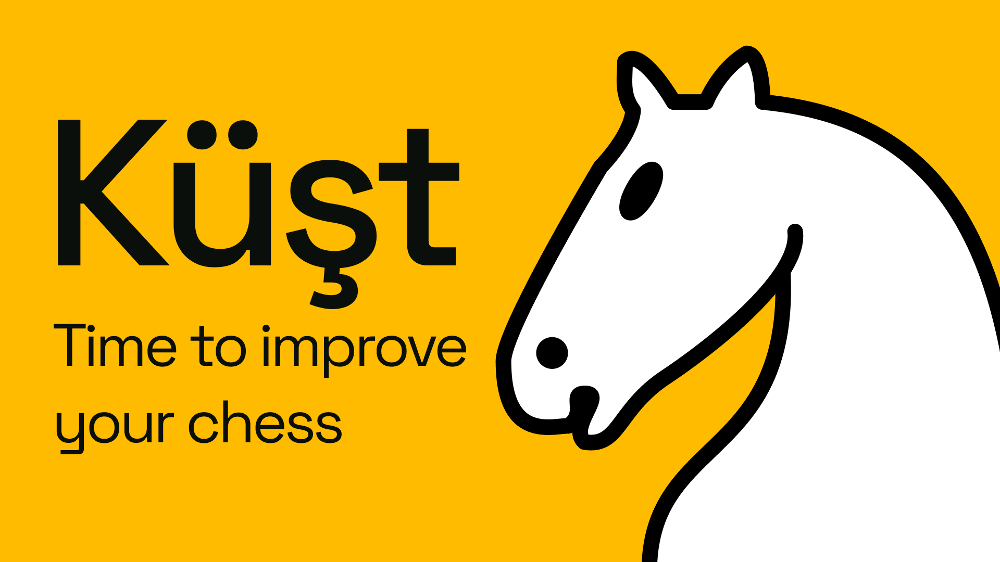

# Küşt



Küşt means chess in Turkmen. It is an open-source chess app for Android and iOS, built with Flutter, that tries to teach you something every game instead of just beating you.

It is also a case study: one author's ideas and system design, built with AI. The author decides what the app should be and how its parts fit together. The AI writes the code, the tests and, occasionally, a confident mistake that the author catches. Every change goes through an issue, a branch and a pull request. We are as surprised as you are that it works.

## What it does

- **Bots with a personality.** Nine opponents from 400 to 2000 Elo. They run on Stockfish, weakened like a person would be: clean openings, shaky middlegames, calm endgames, and no blunders from 1000 up. They think for a human amount of time and talk back.
- **Pass and play.** One phone, two people, optional clocks, pause and abort. No engine, no excuses.
- **Move feedback and review.** Practice mode rates every move from brilliant to blunder, shows hints, undo and a live arrow to the best move. After a game, a review shows accuracy for both sides, who was winning when, and the moves worth learning from.
- **Lessons.** Eleven short lessons from the first pawn move to simple checkmates, played on the board. A new player lands on the first one after setup.
- **Puzzles woven into a carpet.** Five levels of twenty, one traditional Turkmen göl per level, plus a daily puzzle with a streak and a coach.
- **History and replay.** Every game is saved. Step through it with evaluation and best-move arrows, run an analysis, export it as PNG, FEN or PGN.
- **The small things.** Drag and drop, premoves, castling on the rook, four piece sets, sounds and haptics, achievements, a rating that moves.
- **Three languages.** English, Russian and Turkmen. The app follows the phone, and a Turkish phone gets Turkmen.
- **Dark, portrait, offline.** No account, no server. Your games stay on your phone.

## How it is built

| Part | Job |
| --- | --- |
| dartchess | Owns the game: position, legal moves, FEN and PGN |
| Stockfish | Plays the bots, gives hints, evaluates and rates moves |
| Riverpod, go_router | State and navigation |
| Hive, shared_preferences | Ratings, puzzle progress, history, settings |

The rule that keeps it sane: Stockfish never decides what is legal. `dartchess` owns the game, and the engine only sees FEN strings. Bots search at full strength, then a policy picks a move the way a player of that rating would. Game results are stored as data, not as sentences, which is how three languages fit in one app.

Stockfish runs on Android and iOS. Anywhere else, or if the engine fails, Küşt offers pass and play instead of freezing.

## Run it

You need the Flutter SDK, Git, and an Android or iOS device or emulator.

```bash
git clone https://github.com/Shapak-Apps/kust.git
cd kust
python3 tools/pack_nnue.py   # one time: downloads and packs the engine networks
flutter pub get
flutter run
```

The two NNUE networks (about 110 MB) ship inside the app so bots work offline, but they are not committed to git. `tools/pack_nnue.py` fetches them from `data.stockfishchess.org`, checks their hashes and packs them into `assets/engine/`, which is git-ignored. Without them the app still builds and offers pass and play.

Release builds are signed with `android/key.properties`, which is not committed:

```properties
storeFile=../upload-keystore.jks
storePassword=...
keyAlias=upload
keyPassword=...
```

Without that file a release build falls back to the debug key. Never publish such a build.

```bash
flutter build apk --release --split-per-abi
```

## Translations

Texts live in `lib/l10n/app_en.arb`, `app_ru.arb` and `app_tk.arb`. Turkmen strings that need a native speaker's eye are listed in `l10n/REVIEW_tk.md`.

## Roadmap

Done: bots, pass and play, clocks, hints, undo, premoves, ratings, evaluation bar, five puzzle levels, daily puzzle, achievements, history and replay, analysis, move feedback, export, three languages.

Next:
- [ ] Online play with accounts and friends
- [ ] More puzzle levels and themes
- [ ] Opening and endgame insights
- [ ] Explanations for critical moves
- [ ] Training built from your own mistakes

## Contributing

Fork, branch, change, open a pull request. Format and test first:

```bash
dart format .
flutter test
```

Chess has more edge cases than it looks. Changes to chess logic should come with tests: check, checkmate, castling, en passant, promotion, repetition, the fifty-move rule.

## License

GNU General Public License v3.0, see [LICENSE](LICENSE). Küşt uses [Stockfish](https://stockfishchess.org/) and [dartchess](https://pub.dev/packages/dartchess), both GPL-3.0, and [Flutter](https://flutter.dev/). Follow the licence and attribution terms of each.
